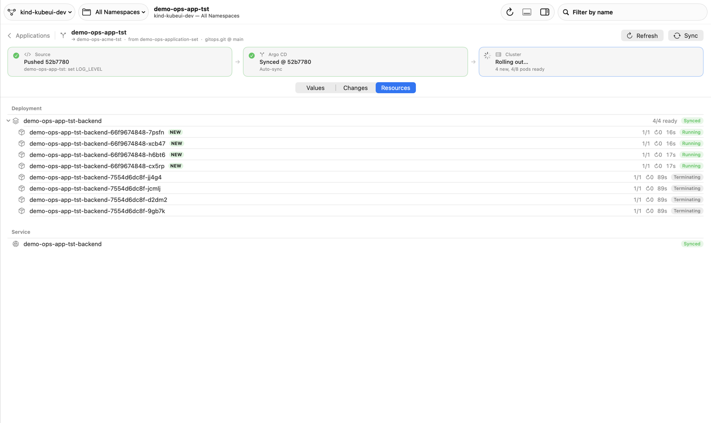
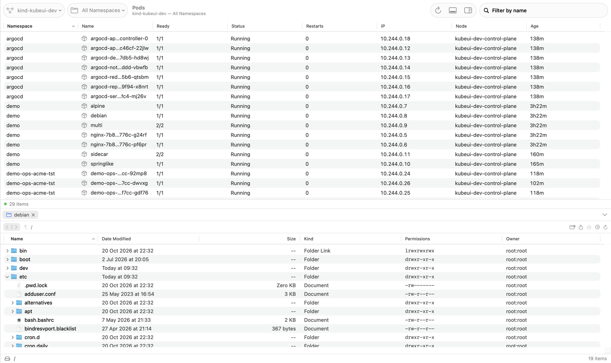
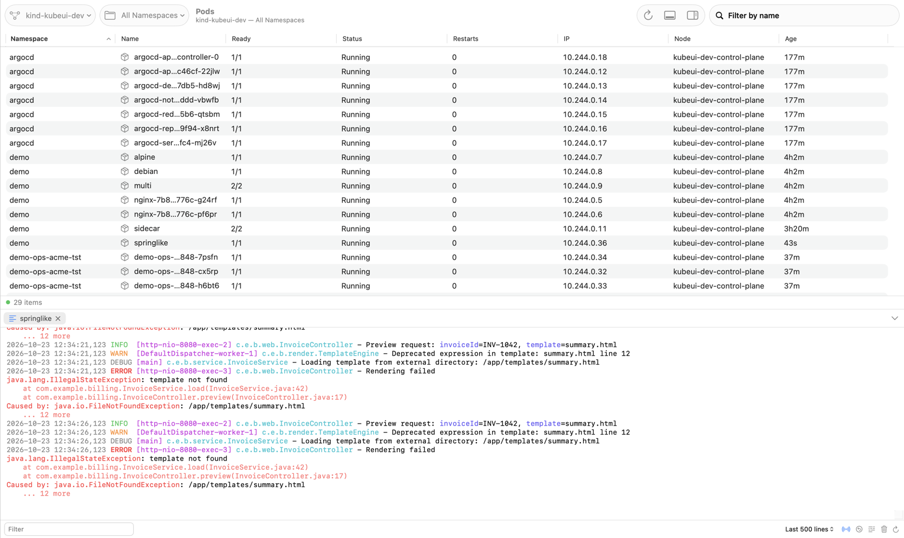
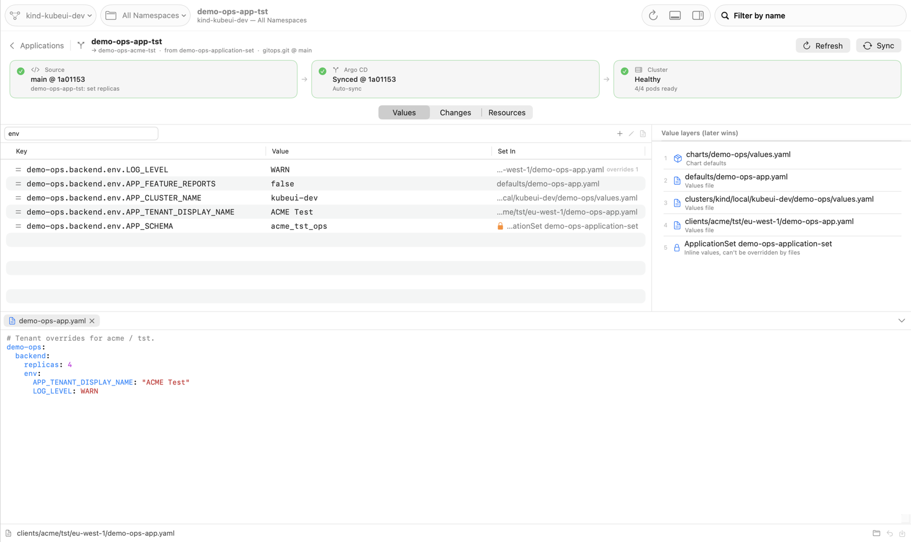
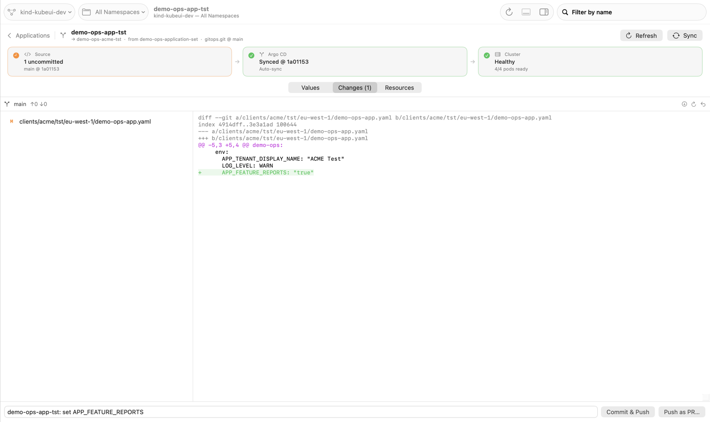

# KubeUI

A native macOS app for working with Kubernetes clusters. It browses resources k9s-style, has a
Finder-style file browser for pods with drag & drop, and layers Argo CD and your GitOps repo on
top, so a config change goes from edit to running pods in one window.



## Features

### Cluster browser

- Pick a context and namespace in the toolbar and a resource kind in the sidebar.
  - Kinds: pods, deployments, stateful sets, daemon sets, replica sets, jobs, cron jobs, services,
    ingresses, config maps, secrets, volume claims, nodes, namespaces and events.
  - Lists update live through `kubectl` watches.
- Right-click a row for Browse Files, Show Logs, Open Shell, Show YAML, Describe, Scale, Restart,
  Copy Name and Delete. Destructive actions confirm and name the context.
- Double-click a pod to browse its files, or an Argo CD application to open it. Other kinds show
  their YAML.
- The inspector (⌥⌘I) follows the selection. For pods, every container (init containers and
  sidecars included) shows:
  - its image, registry, repository and tag
  - the digest actually running
  - pull policy, start time, restarts and last exit
- KubeUI never changes your kubeconfig's current context. Each window has its own (⌘N for another).

### Bottom panel

Logs, files, YAML, describe output and shells open as tabs in a panel under the list, like Xcode's
debug area. ⇧⌘Y shows or hides it, and you drag its top edge to resize it. Tabs keep running in the
background.



- **Files:** Finder's list view for a container's filesystem.
  - Folders expand in place.
  - Drag files or folders from Finder onto the list or onto a folder row to upload. Drag items
    out to Finder to download.
  - Double-click a file to open it locally.
  - Shortcuts: ⌘↓ opens a folder as the root, ⌘↑ goes to the enclosing folder, ⌘[ / ⌘] go back
    and forward, ⇧⌘G goes to a path, ⇧⌘N makes a folder, ⌘⌫ deletes.
  - Needs `sh` and `tar` in the container, as `kubectl cp` does. Distroless images aren't supported yet.
- **Logs:** streaming `kubectl logs` with syntax highlighting for timestamps, levels, threads,
  loggers and stack traces. A console-style bar has a filter, container and line-count pickers,
  and Follow, Previous, Wrap and Clear (⌘K).
- **Shell:** `kubectl exec -it` in a terminal tab (bash when the image has it, otherwise sh).
  Open Shell in Terminal uses Terminal.app instead.
- **YAML and Describe** are syntax-highlighted, with the find bar (⌘F).



### Argo CD and GitOps

When the cluster serves Argo CD's API, the sidebar gains an **Argo CD** section. An application
opens as one pipeline: **Source** (your clone) → **Argo CD** (sync) → **Cluster** (health, pods).
Each stage lights up as a change moves from your edit to running pods.

- **Link your GitOps clone** once per repo URL, from the banner above Applications or an
  application's Source card. KubeUI uses your own `git` and credentials, and checks the clone's origin.
- **Values** merges the app's Helm values the way Helm does, whatever the chart's structure. The
  layers are the chart's `values.yaml`, then each `valueFiles` entry Argo CD resolved, then inline
  values from the ApplicationSet. Every key shows the layer that wins it, and search finds any key or value.
  - Edit or add any value. Typed values are written as YAML (`3` stays a number). Only the changed
    lines are rewritten, keeping comments and formatting.
  - Edits default to the safe file: the one that already sets the key when it's tenant or cluster
    specific, otherwise the most specific file. A shared `defaults/` value gets an override
    instead of changing every tenant. Keys pinned inline by an ApplicationSet are locked.
  - Double-click a layer to edit the whole file in the panel, for lists and multi-line values.
- **Changes** shows the diff with a suggested commit message.
  - **Commit & Push** pushes to the branch Argo CD tracks, asks Argo CD to refresh, and follows the
    rollout until new pods are ready.
  - **Push as PR…** pushes a branch and opens GitHub's pull request page.
- **Resources** lists what Argo CD manages, with live readiness and pods. New pods are marked, and
  you can right-click a pod for logs, files or a shell.





## Requirements

- macOS 15 or later, Xcode 26 or later.
- `kubectl` on your machine. KubeUI runs it with your login shell's environment, so exec auth
  plugins such as `aws` work as they do in Terminal.
- The only third-party dependency is [SwiftTerm](https://github.com/migueldeicaza/SwiftTerm) (MIT)
  for the shell panel. It's pinned to 1.11.x because later releases need Xcode's separately
  downloaded Metal Toolchain.

## Build and run

Open `KubeUI.xcodeproj` and press ⌘R, or:

```bash
xcodebuild -project KubeUI.xcodeproj -scheme KubeUI -derivedDataPath build/DerivedData build
```

```bash
open build/DerivedData/Build/Products/Debug/KubeUI.app
```

A new window opens on your kubeconfig's current context. Switch to a test cluster before trying
destructive actions.

## Tests

```bash
cd KubeKit && swift test
```

Unit tests cover:

- JSON streaming, resource columns and pod status
- tar writing, checked against the system `tar`
- the YAML editor and Helm value merging
- git operations, against a temporary repo
- kubectl argument building

Integration tests (pod file upload, list and download, and watches) run only against a cluster:

```bash
cd KubeKit && KUBEUI_TEST_CONTEXT=kind-kubeui-dev KUBEUI_TEST_POD=demo/alpine swift test
```

## Local playground

A [kind](https://kind.sigs.k8s.io) cluster with a few demo pods:

```bash
brew install kind && kind create cluster --name kubeui-dev
```

`kind create cluster` switches your kubeconfig's current context to the new cluster; switch back
with `kubectl config use-context <previous>` if you rely on it in a terminal.

```bash
kubectl --context kind-kubeui-dev create namespace demo
```

```bash
kubectl --context kind-kubeui-dev -n demo run alpine --image=alpine:3.20 --command -- sleep infinity
```

```bash
kubectl --context kind-kubeui-dev -n demo run debian --image=debian:bookworm-slim --command -- sleep infinity
```

Argo CD and a GitOps repo on top of it:

```bash
scripts/kind-gitops-demo/setup.sh ~/Projects/kubeui-demo-gitops
```

The script installs Argo CD and an in-cluster git server. It seeds a repo shaped like
a typical ApplicationSet-based GitOps repo (an ApplicationSet with defaults → clusters → clients value files) and
clones it to the given folder; link that clone in KubeUI.

The clone's `origin` is the same in-cluster URL Argo CD uses, and a git `insteadOf` rule sends
fetch and push through `kubectl port-forward` on port 9418. The script starts the port-forward if
it isn't running; keep it running while you push. Re-running the script is safe.

## Project layout

| Path | What |
|---|---|
| `KubeKit/` | Swift package, no UI. It holds the kubectl runner, watches, resource columns, pod file operations and tar writer, plus Argo CD models, Helm value layers, the YAML editor and git. Tests are here too. |
| `KubeUI/` | The app: SwiftUI, with AppKit for the file outline and text views. |
| `KubeUI.xcodeproj` | Xcode project. The `KubeUI/` folder is synchronized, so new files are picked up automatically. |
| `scripts/kind-gitops-demo/` | The Argo CD + GitOps playground. |
| `scripts/make-icon.swift` | Draws the app icon into `KubeUI/Assets.xcassets`. |
| `docs/DESIGN.md` | Design notes, including why `kubectl` is the transport. |

## Debug hooks

Debug builds read these environment variables, used for scripted UI checks and the screenshots above:

- `KUBEUI_SNAPSHOT_DIR=<dir>` writes a PNG and a view-tree dump of every window every 2 seconds.
- `KUBEUI_OPEN=<kind>:<namespace>/<name>,…` opens panel tabs at launch. The kinds are `files`, `logs`
  and `shell` (for a pod) and `app` (for an Argo CD application).
- `KUBEUI_EXPAND=/etc,/usr` expands those folders in the last opened Files tab.
- `KUBEUI_SHELL_INPUT=<text>` is typed into an opened shell (`\n` for Return).
- For an opened application:
  - `KUBEUI_VALUE_SET=a.b.KEY=VALUE` edits its values, and `KUBEUI_PUSH=1` then commits and pushes.
  - `KUBEUI_APP_SECTION=Values|Changes|Resources` picks the section shown first.
  - `KUBEUI_OPEN_LAYER=<n>` opens value layer n in the editor.
  - `KUBEUI_VALUES_SEARCH=<text>` pre-fills the Values search.
- `KUBEUI_INSPECT=<namespace>/<pod>` selects that pod with the inspector open.
